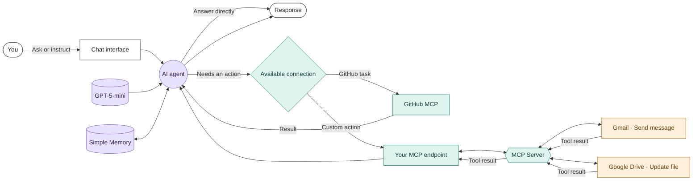

# MCP Assistant | Connecting an AI Agent to Real Tools

An AI assistant built with **n8n and the Model Context Protocol (MCP)**. It combines a conversational interface with connections to GitHub, Gmail, and Google Drive, allowing an AI agent to use external tools instead of relying only on text generation.

## What this project explores

An AI assistant becomes more useful when it can interact with the systems people already use.

This project explores how MCP can connect a conversational AI agent to external capabilities while keeping the tool integrations separate from the user-facing workflow.

The implementation consists of two n8n workflows:

- **MCP Client:** Handles the conversation, AI reasoning, memory, and tool selection.
- **MCP Server:** Exposes selected Google Drive and Gmail operations through an MCP endpoint.

The client also connects to GitHub MCP.

## How the system works



The diagram illustrates the intended interaction between the workflows. The agent can answer directly or use a connected tool, then incorporate the result into its response.

## The two workflows

### 1. MCP Client

**File:** `MCP CLIENT.json`

The client is the conversational layer of the project. It receives user messages and passes them to an AI agent powered by OpenAI GPT-5-mini.

Its responsibilities include:

- Receiving messages through the chat interface.
- Maintaining conversation context using memory.
- Determining when an external tool is needed.
- Connecting to the custom MCP server and GitHub MCP.
- Using tool results to formulate a response.

### 2. MCP Server

**File:** `MCP Server.json`

The server exposes selected operations through an MCP endpoint so the client can access them through a standardized tool interface.

The configured operations include:

- **Gmail:** Send an email message.
- **Google Drive:** Update a file.

These are specific configured capabilities, not unrestricted access to every operation in Gmail or Google Drive.

## Features

- Conversational AI interface.
- AI-driven tool selection.
- MCP-based integrations.
- GitHub MCP connection.
- Google Drive file-update capability.
- Gmail message-sending capability.
- Conversation memory.
- Separate client and server workflows.

## Technology

| Component | Purpose |
|---|---|
| n8n | Workflow orchestration |
| Model Context Protocol | Standardized tool communication |
| OpenAI GPT-5-mini | AI reasoning and response generation |
| Simple Memory | Conversation context |
| GitHub MCP | Access to configured GitHub tools |
| Google Drive | File-update operation |
| Gmail | Email-sending operation |

## Getting started

### Requirements

- An n8n instance.
- OpenAI API access for the configured model.
- Access to the Google services used by the workflows.
- A configured GitHub MCP connection.
- An MCP endpoint reachable by the client workflow.

### Setup

1. Clone or download this repository.
2. Open n8n and import `MCP Server.json`.
3. Configure the Google Drive and Gmail credentials used by the server.
4. Activate or expose the server workflow as appropriate for your n8n setup.
5. Configure the MCP endpoint in `MCP CLIENT.json`.
6. Import the client workflow.
7. Configure the OpenAI model, memory, and GitHub MCP connection.
8. Test a normal conversational message first, then test each connected tool independently.

Node names, credential fields, and endpoint settings may need adjustment for your n8n version and environment.

## Example interactions

These are illustrative test prompts, not claims of completed execution.

| User request | Intended behavior |
|---|---|
| Ask a general question | Generate a response through the AI agent |
| Request an email to be sent | Use the configured Gmail operation |
| Request an update to a Drive file | Use the configured Google Drive operation |
| Ask for a supported GitHub action | Use an available GitHub MCP tool |

The actual outcome depends on the tools, permissions, credentials, and inputs configured in n8n.

## Repository structure

```text
MCPAssistant-n8n/
├── MCP CLIENT.json
├── MCP Server.json
└── README.md
```

## Product and engineering takeaways

This project demonstrates a useful architectural distinction: the conversational agent does not need to contain every external integration directly. A separate tool layer can expose capabilities that the agent can use when relevant.

It also highlights practical considerations for AI-powered workflows:

- Tool access should be scoped to the operations actually required.
- The agent must interpret tool results before responding.
- Credentials and endpoint configuration need to be managed separately from workflow logic.
- Tool failures and ambiguous requests need clear handling.
- Actions with real-world consequences should have appropriate authorization and confirmation safeguards.

## Potential improvements

- Add explicit confirmation before consequential actions.
- Add error handling for unavailable services and failed tool calls.
- Validate tool inputs before execution.
- Add structured logs for tool calls and failures.
- Expand the available operations only when there is a clear user need.
- Add test cases for successful, invalid, and unauthorized requests.

## Security considerations

**Do not publish credentials or private endpoints.**

Before sharing workflow exports publicly:

- Remove API keys, OAuth tokens, personal account details, and sensitive identifiers.
- Replace private endpoints with placeholders.
- Review every node's configuration for exposed information.
- Rotate any endpoint or credential that may already have been exposed.
- Review Git history as well as the current files, because removing sensitive information from the latest commit does not remove earlier copies.

## Project scope

This repository contains exported n8n workflows intended for learning, experimentation, and further development. It is not a claim of production readiness or unrestricted access to connected services.
